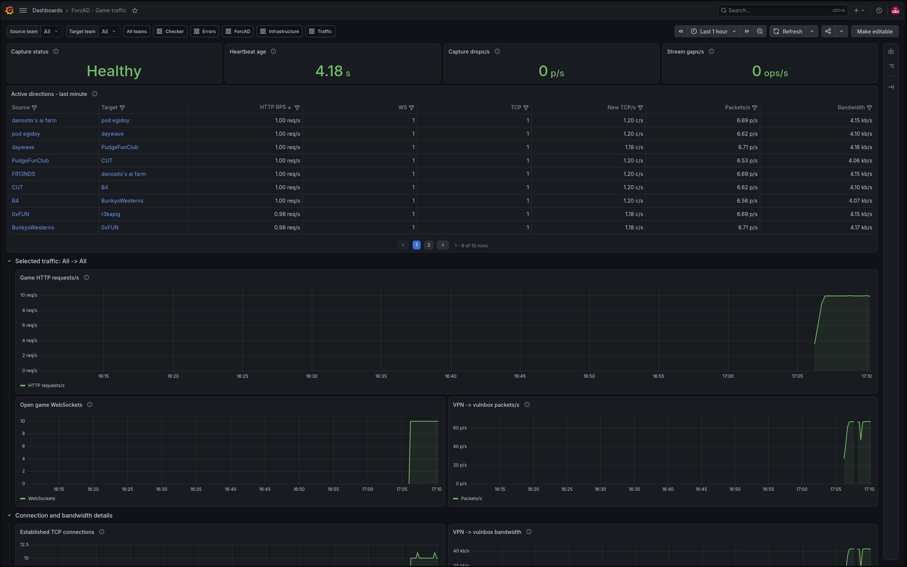

# ForcAD


ForcAD is a capture-the-flag attack-defense platform.

## Choose a setup

- **Manual application:** run ForcAD and its dependencies with Docker Compose on one host. Follow this guide.
- **Full infrastructure:** generate and install separate Debian Router, VPN and ForcAD hosts with the [infrastructure guide](infrastracture/README.md).
- **Local network demo:** run the [five-team WireGuard demo](deployment/demo/README.md) on a Linux workstation.

## Manual application setup

Install Go matching [backend/go.mod](backend/go.mod), GNU Make, Docker and the
Docker Compose v2 plugin. From the repository root, create the config files:

```sh
cp -n config/config.yml.example config/config.yml
cp -n frontend/.env.example deployment/docker/.env
```

Edit `config/config.yml` with the game schedule, teams, tasks and service
settings. It seeds a new database; PostgreSQL is authoritative after
initialization. Add executable checkers under `checkers/` and list their Python
dependencies in `checkers/requirements.txt`. Start with the
[reference checker](checkers/examples/README.md).

If players will use a public hostname or reverse proxy, set `PUBLIC_ORIGIN` in
`deployment/docker/.env` to the exact browser origin, including scheme and port
when present, with no path. Admin mutations reject a different origin. See
[Configuration](docs/CONFIGURATION.md#compose-environment) for proxy settings.

Run setup and start the containers:

```sh
./control.sh setup
./control.sh start
```

`start` does not start a game session. Open the board at
<http://127.0.0.1:8080/> and the admin panel at
<http://127.0.0.1:8080/admin/>. Start a practice or final session from the
admin panel, or let the configured schedule start the final. Setup writes the
admin credentials to the private `config/runtime/admin.env` file.

Use `./control.sh compose ...` or `rd` for raw Compose commands so external
storage settings are included. See [Control CLI](docs/CONTROL.md) for the full
command list and [Operations](docs/OPERATIONS.md) before updates or resets.

## Monitoring

Set `GRAFANA_ADMIN_PASSWORD` in `deployment/docker/.env`, then run:

```sh
./control.sh monitoring up -d
```

Grafana and Prometheus listen on localhost on the ForcAD host. See
[Monitoring](docs/MONITORING.md) for the SSH tunnel, dashboards and the separate
Router exporter setup for game traffic metrics.



## Documentation

| Guide | Contents |
| --- | --- |
| [Configuration](docs/CONFIGURATION.md) | Game fields, credentials and settings that change after initialization |
| [Control CLI](docs/CONTROL.md) | Operator commands and compatibility aliases |
| [Operations](docs/OPERATIONS.md) | Scaling, resource limits, updates and resets |
| [Monitoring](docs/MONITORING.md) | Application metrics, network traffic, dashboards and access |
| [Checkers](docs/CHECKERS.md) | Checker arguments, output and status contract |
| [Architecture](docs/ARCHITECTURE.md) | Process roles, data flow and backend layout |
| [Development](docs/DEVELOPMENT.md) | Toolchain, code generation, tests and benchmarks |
| [Frontend](frontend/) and [branding](frontend/BRANDING.md) | React source and public theme settings |
| [Security checks](security/README.md) | Source, dependency and image checks |

Prepare a development checkout with:

```sh
make -C backend sync
make -C frontend sync
```

See the [development guide](docs/DEVELOPMENT.md#tests) for build and test
commands.
