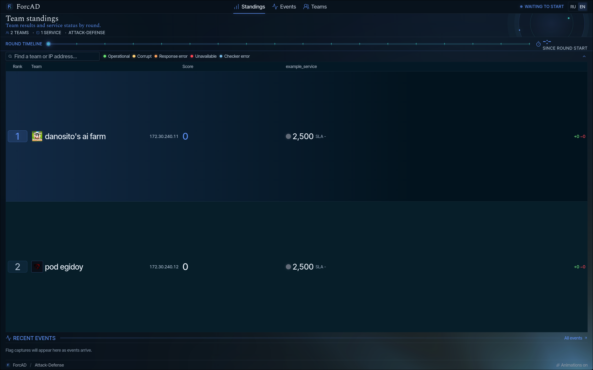

# ForcAD



## Start a game

Install Go matching [backend/go.mod](backend/go.mod), GNU Make, and Docker with a
current Compose v2 plugin. The application images build the frontend and checker
environment; Node and Python are only needed on the host for development.

Run from the repository root, using a fresh database for the first installation:

```bash
cp -n config/config.yml.example config/config.yml
cp -n frontend/.env.example deployment/docker/.env
```

Edit `config/config.yml`: set a future final start time, team IPs and service
settings. `deployment/docker/.env` contains the public frontend name, logo and
colors; edit it for your event or keep the ForcAD defaults. `control.sh` passes
this directory to Compose, which loads its `.env` for the image build.

Install your executable checkers under `checkers/` and list their Python
dependencies in `checkers/requirements.txt`. The configuration points to the
[reference checker](checkers/examples/README.md); adapt it to your service before
starting a game. Then run:

```bash
./control.sh setup
./control.sh start
```

Open the scoreboard at `http://127.0.0.1:8080/` and the admin panel at `/admin/`.
Setup writes admin credentials to `config/runtime/admin.env`; keep that file,
`config/config.yml` and its backups private.

The admin panel starts practice or final sessions and pauses or finishes a game.
The configured date also starts the final automatically. Editing the YAML after
initialization does not overwrite the game stored in PostgreSQL.

```bash
./control.sh ps
./control.sh logs --tail 100 receiver worker ticker
./control.sh status
```

`./control.sh --help` lists the operator commands. The launcher builds the Go
binary using Go's build cache and resolves paths from its own location. It
downloads any missing Go dependencies automatically; a separate `go mod download`
step is unnecessary.
Use `./control.sh compose ...` (or `rd`) so generated external-storage settings
are included.
Container recreation preserves PostgreSQL game data. Importing a
previous Python installation's database is not supported automatically.

## Monitoring

After starting ForcAD, set `GRAFANA_ADMIN_PASSWORD` in `deployment/docker/.env`, then run:

```bash
./control.sh monitoring up -d
```

Open [Grafana](http://127.0.0.1:3000/) and log in as `admin` with that password.
This enables ForcAD application metrics. For team-to-team game traffic, also
install the router counters and Zeek sensor using the
[infrastructure guide](infrastracture/forcad/README.md#monitoring).
See [Monitoring](docs/MONITORING.md) for dashboards, remote access and coverage.

## Documentation

| Guide | Contents |
| --- | --- |
| [Configuration](docs/CONFIGURATION.md) | Rounds, scheduling, teams, tokens and service settings |
| [Control CLI](docs/CONTROL.md) | Operator commands, options and compatibility with the old CLI |
| [Operations](docs/OPERATIONS.md) | Updates, scaling, resource limits, diagnostics and resets |
| [Monitoring](docs/MONITORING.md) | ForcAD metrics, game traffic, dashboards and collection limits |
| [Infrastructure](infrastracture/README.md) | Network diagram, config generation and Debian VPN/router/ForcAD setup |
| [Local demo](deployment/demo/README.md) | Two teams, real WireGuard, router ACLs/SNAT and game traffic graphs |
| [Checkers](docs/CHECKERS.md) | CHECK/PUT/GET arguments, output and exit codes |
| [Architecture](docs/ARCHITECTURE.md) | Process roles, data flow and backend layout |
| [Development](docs/DEVELOPMENT.md) | Dependencies, code generation and tests |
| [Frontend](frontend/) | React application, API access and UI source |
| [Branding](frontend/BRANDING.md) | Public theme settings and assets |
| [Security checks](security/README.md) | Source, dependency and image checks |

## Repository

| Directory | Purpose |
| --- | --- |
| `api/` | Shared OpenAPI sources and generation scripts |
| `backend/` | Go application, SQL, backend Dockerfile and integration tests |
| `frontend/` | React application, frontend Dockerfile and browser tests |
| `deployment/` | Compose, nginx and container helper scripts |
| `infrastracture/` | A/D network diagram, host config templates, generators and deployment guides |
| `config/` | Game configuration example and private deployment configuration |
| `checkers/` | Organizer-supplied checker programs and dependencies |
| `public/` | Public branding and optional team logos |
| `scripts/`, `security/` | Development tools and verification commands |

From the repository root, prepare a development checkout with:

```sh
make -C backend sync
make -C frontend sync
```

Each component has its own `build`, `lint` and `test` targets. Deployment checks
live in `deployment/Makefile` and use isolated test deployments; see
[Development](docs/DEVELOPMENT.md#tests) for their scope.
