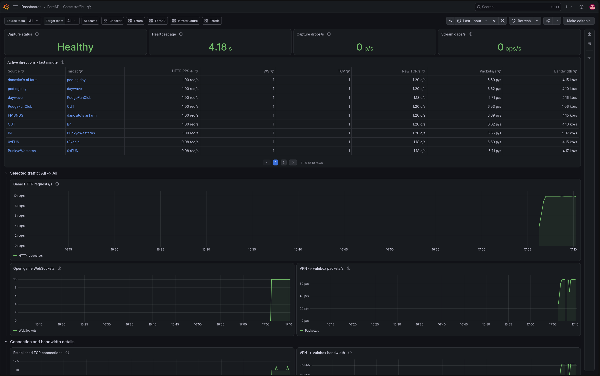

# ForcAD

ForcAD runs attack-defense CTFs: it schedules service checks, accepts flags and publishes the scoreboard.

## Plan an event

For a 10-team rehearsal, start with **8-12 vCPU and 16 GiB RAM** for the ForcAD VM. Size it for the number of services, checker duration and round time. See [hardware sizing](docs/OPERATIONS.md#sizing-the-forcad-host) and the [Router, VPN and ForcAD installation guide](infrastracture/README.md).

At the Russian Championship final, a **24 vCPU / 32 GiB VM** ran four workers with eight checker slots each for 21 competing teams and one NPC. Teams submitted over 100,000 flags in 240 minutes; `daywave.` submitted about 25,000 on one service. The organizers reported 100% uptime and no HTTP 5xx responses.

The physical host (not a VM requirement) had two AMD EPYC 7662 CPUs (64 cores / 128 threads, 2.0 GHz base, up to 3.3 GHz, 225 W each), 240 GiB DDR4 ECC (15 x 16 GiB) and two 2 TB Intel DC P4510 U.2 SSDs in RAID 1.

## Manual application setup

For a self-contained rehearsal, use the [local WireGuard demo](deployment/demo/README.md). To run the application on one host instead, install the [project's Go version](backend/go.mod), GNU Make, Docker and the Compose v2 plugin. From the repository root:

```sh
cp -n config/config.yml.example config/config.yml
cp -n frontend/.env.example deployment/docker/.env
```

1. Set the schedule, teams and services in `config/config.yml`. It seeds a new database; PostgreSQL owns the game state after initialization.
2. Put executable checkers under `checkers/` and their Python dependencies in `checkers/requirements.txt`. See the [reference checker](checkers/examples/README.md).
3. For a public hostname or reverse proxy, set `PUBLIC_ORIGIN` in `deployment/docker/.env` to the exact browser origin (scheme, host and port, no path). See [proxy settings](docs/CONFIGURATION.md#compose-environment).

```sh
./control.sh setup
./control.sh start
```

Open the [scoreboard](http://127.0.0.1:8080/) or sign in to [admin](http://127.0.0.1:8080/admin/) with the credentials in `config/runtime/admin.env`. Starting containers does not start a game: use the admin panel for practice or a final, or let the final start on schedule.

## Documentation

| Task | Guide |
| --- | --- |
| Configure the event or operate the board | [Configuration](docs/CONFIGURATION.md), [control commands](docs/CONTROL.md), [operations and backups](docs/OPERATIONS.md) |
| Monitor services and network traffic | [Prometheus, Grafana and Zeek](docs/MONITORING.md) |
| Write a service checker | [Checker protocol](docs/CHECKERS.md) |
| Work on ForcAD | [Architecture](docs/ARCHITECTURE.md), [build and tests](docs/DEVELOPMENT.md), [frontend branding](frontend/BRANDING.md) |
| Check dependencies, source and images | [Security checks](security/README.md) |

## Screenshots




[GNU General Public License v3](LICENSE)
