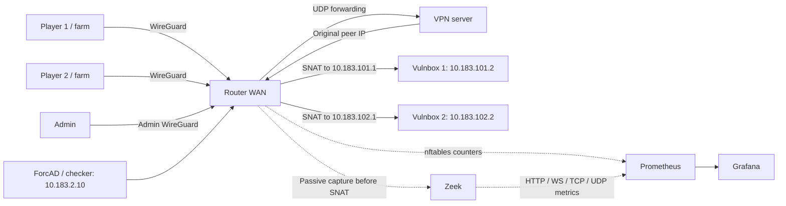

# Local network demo

Five notes services, player flag farms, participant/admin WireGuard, generated
firewalls, Zeek, ForcAD, Prometheus and Grafana. Published host ports bind to
localhost. `/demo/flags` intentionally exposes flags to demo farms.
Teams: danosito's ai farm, pod egidoy, daywave, PudgeFunClub and CUT.
The diagram shows two of the five identical team segments.



## Start

Use a disposable game database. Requirements: Linux Docker with kernel WireGuard,
Compose 2.36+ (`interface_name`), host `wg`, Go, Make, Python 3.11+ with venv, and
Node/pnpm for `sync-codegen`. See [toolchain versions](../../docs/DEVELOPMENT.md#toolchain).

Edit [settings.toml](settings.toml) for the demo teams, game and task.
On a fresh demo, `up` creates `config/config.yml` from these settings and
generates team tokens. With an existing database, keep its current tokens in
`config/config.yml`; game and task settings must match the TOML. From the
repository root:

```sh
make -C backend sync-codegen
bash deployment/docker/scripts/demo.sh up
```

`up` builds and recreates the full stack, retaining volumes. It uses the same
settings schema as infrastructure, creates missing VPN keys and stores private
runtime files in `config/runtime/demo/`. Team containers, networks and clients
are generated from `teams.entries` (2..32 teams). Appending entries adds teams
through the admin API and extends the VPN without rotating existing keys.
Existing teams, scores and tokens are preserved. Reordering/removing teams or
changing an existing network is refused; use a separate disposable deployment.
Use `demo.sh` for this stack so all Compose overlays remain enabled.

| Open | Login |
| --- | --- |
| [Board](http://localhost:8080/) / [admin](http://localhost:8080/admin/login) | `config/runtime/admin.env` |
| [Game traffic](http://localhost:3000/d/forcad-game-traffic) / [board traffic](http://localhost:3000/d/forcad-traffic) | `admin`, password in `config/runtime/demo.env` |
| [Prometheus targets](http://localhost:9090/targets) | None |

Start practice in the board admin panel. Allow two rounds for checker results
and about one minute for rates. Farms send HTTP in a ring (1 -> 2 -> ... -> 5 -> 1),
keep one WS each, send TCP/UDP echoes and submit flags. On Game traffic, sort active directions
by load and click a team name to inspect a pair. **All teams** clears filters.

## Exercise the network

```sh
bash deployment/docker/scripts/demo.sh test
bash deployment/docker/scripts/demo.sh phase pre-game
bash deployment/docker/scripts/demo.sh phase game
bash deployment/docker/scripts/demo.sh load 1 --rps 20 --seconds 45 --ws 5
api/.venv/bin/python deployment/demo/timing.py --rounds 5
```

`test` checks WireGuard, SNAT, management ownership, isolation, private metrics,
blocked direct vulnbox relays, pre-game ping-only access, admin/checker access,
local vulnbox filtering and Prometheus attribution. It restores the prior phase
and removes its temporary filter. Farms may time out during pre-game.

After five completed practice rounds, `timing.py` saves dispatch and completion
offsets from PostgreSQL to `config/runtime/demo/timing.json`. It only reads state.
These timestamps describe whole checker jobs; they do not measure individual
CHECK/PUT/GET calls or prove resistance to service availability manipulation.

## Availability experiment

The demo explicitly sets `[game] extra_checks = 2` in `settings.toml`.
Two additional CHECK-only jobs per team/task/round sample availability at random
times beyond the main workflow, without extra flag writes. The experiment tests
whether they catch outages missed by that workflow; two is not a proven optimum.
Times survive restart and shift across a pause. All three jobs contribute to
one round result; a later UP cannot erase an earlier service failure.

Normal installations default to `0` (opt-in). Extra CHECKs add load and make the
round's SLA result stricter. The five-team demo is too small to justify a general
default of `2`; validate real checkers and the expected load before enabling it.
See [configuration](../../docs/CONFIGURATION.md#game) for limits and setup.

On a running practice session with 60-second rounds:

```sh
api/.venv/bin/python deployment/demo/availability.py healthy --rounds 3
api/.venv/bin/python deployment/demo/availability.py fault --rounds 5
api/.venv/bin/python deployment/demo/availability.py pause
```

`healthy` checks that all five teams pass. `fault` blocks team 3's notes port
for 22 seconds after each 15-second available interval, independently of checker
timing; the other four teams remain controls. It removes its nftables table
on exit. `pause` pauses through the admin API, restarts ticker/worker, resumes,
and verifies pending IDs, shifted times and successful completion.
Reports stay in `config/runtime/demo/availability-*.json`.
These are local fault tests, not production capacity or continuous uptime proofs.
See the [recorded experiment](availability.md) for results and the default decision.

`phase` changes router access independently of the board session. Demo starts in
`game` and remembers later phase changes; host configs default to `pre-game`.

`load N` targets the next team's vulnbox from player N; the last targets team 1. Limits: 100 RPS,
300 seconds, 20 WS. Targets are fixed local fixtures; no flags or board requests
are sent. Game graphs should rise independently of board graphs.

| Port | Fixture |
| --- | --- |
| TCP/8080 | Notes, flags, `/health` with observed source IP |
| TCP/8081 | WS echo at `/ws` |
| TCP/9001 | TCP echo |
| UDP/9000 | UDP echo |
| TCP/22 | Management ACL probe, not SSH |

## Manage

```sh
bash deployment/docker/scripts/demo.sh ps
bash deployment/docker/scripts/demo.sh logs -f demo-farm1 demo-farm2 demo-sensor
bash deployment/docker/scripts/demo.sh stop
bash deployment/docker/scripts/demo.sh start
bash deployment/docker/scripts/demo.sh down
```

`down` preserves database, notes and monitoring data. Secrets are ignored by Git
and excluded from image layers and command arguments.

Old demo pairs `172.30.240.11`/`.12` and `10.101.0.2`/`10.102.0.2` migrate
automatically. The script saves `config/config_backup_demo_network.yml` and updates matching database records,
retaining names, tokens, scores and session state. Existing VPN configs move to
`10.183.200.0/24` and `10.183.201.0/24` without changing keys; the old bundle stays
in `config/runtime/demo/wireguard-before-network/`. VPN expansion also keeps a
`wireguard-before-N-peers/` backup. An interrupted team addition can be retried
with `up`; its private `teams-pending.json` journal prevents duplicate creation.
Unrecognized database teams are refused.
Before replacing old ephemeral notes containers, save their SQLite database if
needed. `config/runtime/demo/seeds/team1/note.db` and `team2/note.db` seed empty
notes volumes once; later starts use persistent volumes.

## Limits

- Router/VPN rules are the generated host rules. Internal Docker bridges model
  VLANs; interfaces are named `eth3.101` through `eth3.105`, but no 802.1Q tags are tested.
  VPN transit uses /29 to accommodate Docker's bridge gateway.
- Nginx, one worker and Prometheus share the ForcAD namespace. Setup routes traffic
  through the router and redirects TCP/80 to Nginx's 8080. Worker metrics use 9091.
  Application containers have no NET_ADMIN.
- Zeek shares the router namespace as UID 10001 with NET_RAW. Demo-only `-C`
  handles veth checksum offload; the host unit keeps checksum validation enabled.
- This tests functionality, not capacity, physical VLAN isolation, Debian boot
  order or hardware MTU. HTTP metrics cover plaintext HTTP/1. Direct vulnbox
  relays are blocked; indirect external relays remain possible.

See [Monitoring](../../docs/MONITORING.md) for metric definitions and limits.
