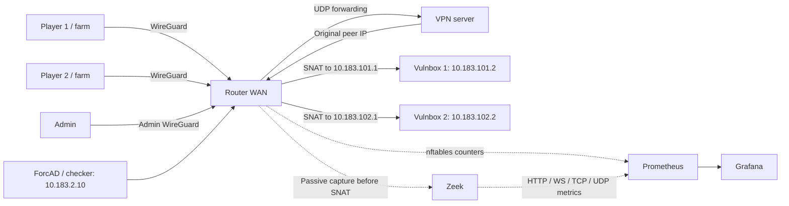

# Local network demo

Two notes services, player flag farms, participant/admin WireGuard, generated
firewalls, Zeek, ForcAD, Prometheus and Grafana. Published host ports bind to
localhost. `/demo/flags` intentionally exposes flags to demo farms.



## Start

Use a disposable game database. Requirements: Linux Docker with kernel WireGuard,
Compose 2.36+ (`interface_name`), host `wg`, Go, Make, Python 3.11+ with venv, and
Node/pnpm for `sync-codegen`. See [toolchain versions](../../docs/DEVELOPMENT.md#toolchain).

Copy `config/config.yml.example` to `config/config.yml` if absent, then configure
exactly two teams:

```yaml
teams:
  - name: Team 1
    ip: 10.183.101.2
    traffic_cidrs: [10.183.101.2/32, 10.183.200.0/29]
    token: null
  - name: Team 2
    ip: 10.183.102.2
    traffic_cidrs: [10.183.102.2/32, 10.183.200.8/29]
    token: null
```

Set the task's `checker: examples/note/checker.py`, `places: 2` and
`checker_type: hackerdom`. New installations generate tokens; an existing
database requires its current tokens in the YAML. From the repository root:

```sh
make -C backend sync-codegen
bash deployment/docker/scripts/demo.sh up
```

`up` builds and recreates the full stack, retaining volumes. It renders
[network.toml](network.toml), creates missing VPN keys and stores private runtime
files in `config/runtime/demo/`. Conflicting existing network settings are refused.
Use `demo.sh` for this stack so all Compose overlays remain enabled.

| Open | Login |
| --- | --- |
| [Board](http://localhost:8080/) / [admin](http://localhost:8080/admin/login) | `config/runtime/admin.env` |
| [Game traffic](http://localhost:3000/d/forcad-game-traffic) / [board traffic](http://localhost:3000/d/forcad-traffic) | `admin`, password in `config/runtime/demo.env` |
| [Prometheus targets](http://localhost:9090/targets) | None |

Start practice in the board admin panel. Allow two rounds for checker results
and about one minute for rates. Farms send HTTP in both directions, keep one WS
each, send TCP/UDP echoes and submit flags. On Game traffic, sort active directions
by load and click a team name to inspect a pair. **All teams** clears filters.

## Exercise the network

```sh
bash deployment/docker/scripts/demo.sh test
bash deployment/docker/scripts/demo.sh phase pre-game
bash deployment/docker/scripts/demo.sh phase game
bash deployment/docker/scripts/demo.sh load 1 --rps 20 --seconds 45 --ws 5
```

`test` checks WireGuard, SNAT, management ownership, isolation, private metrics,
blocked direct vulnbox relays, pre-game ping-only access, admin/checker access,
local vulnbox filtering and Prometheus attribution. It restores the prior phase
and removes its temporary filter. Farms may time out during pre-game.

`phase` changes router access independently of the board session. Demo starts in
`game` and remembers later phase changes; host configs default to `pre-game`.

`load 1` targets vulnbox 2 from player 1; `load 2` reverses it. Limits: 100 RPS,
300 seconds, 20 WS. Targets are fixed local fixtures; no flags or board requests
are sent. Game graphs should rise independently of board graphs.

| Port | Fixture |
| --- | --- |
| TCP/8080 | Notes, flags, `/health` with observed source IP |
| TCP/8081 | WS echo at `/ws` |
| TCP/9001 | TCP echo |
| UDP/9000 | UDP echo |
| TCP/22 | Management ACL probe, not SSH |

## Manage

```sh
bash deployment/docker/scripts/demo.sh ps
bash deployment/docker/scripts/demo.sh logs -f demo-farm1 demo-farm2 demo-sensor
bash deployment/docker/scripts/demo.sh stop
bash deployment/docker/scripts/demo.sh start
bash deployment/docker/scripts/demo.sh down
```

`down` preserves database, notes and monitoring data. Secrets are ignored by Git
and excluded from image layers and command arguments.

Old demo pairs `172.30.240.11`/`.12` and `10.101.0.2`/`10.102.0.2` migrate
automatically. The script saves `config/config_backup_demo_network.yml` and updates matching database records,
retaining names, tokens, scores and session state. Existing VPN configs move to
`10.183.200.0/24` and `10.183.201.0/24` without changing keys; the old bundle stays
in `config/runtime/demo/wireguard-before-network/`. Other inventories are refused.
Before replacing old ephemeral notes containers, save their SQLite database if
needed. `config/runtime/demo/seeds/team1/note.db` and `team2/note.db` seed empty
notes volumes once; later starts use persistent volumes.

## Limits

- Router/VPN rules are the generated host rules. Internal Docker bridges model
  VLANs; interfaces are named `eth3.101`/`eth3.102`, but no 802.1Q tags are tested.
  VPN transit uses /29 to accommodate Docker's bridge gateway.
- Nginx, one worker and Prometheus share the ForcAD namespace. Setup routes traffic
  through the router and redirects TCP/80 to Nginx's 8080. Worker metrics use 9091.
  Application containers have no NET_ADMIN.
- Zeek shares the router namespace as UID 10001 with NET_RAW. Demo-only `-C`
  handles veth checksum offload; the host unit keeps checksum validation enabled.
- This tests functionality, not capacity, physical VLAN isolation, Debian boot
  order or hardware MTU. HTTP metrics cover plaintext HTTP/1. Direct vulnbox
  relays are blocked; indirect external relays remain possible.

See [Monitoring](../../docs/MONITORING.md) for metric definitions and limits.
