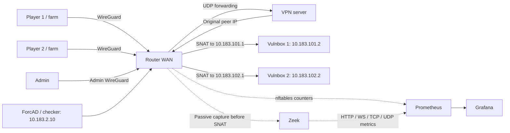

# Local network demo

The Docker Compose demo runs five notes services, flag farms, participant and
admin WireGuard, generated router rules, Zeek, ForcAD, Prometheus, and Grafana.
Published ports bind to localhost. Demo services intentionally expose
`/demo/flags` to their farms. The diagram shows two of the five team segments.



## Requirements

Run on Linux with Docker Engine, kernel WireGuard support, and the `wg` tool.
The demo also requires Compose 2.36 or later for `interface_name`, Go, Make,
Python 3.11+, Node.js, and pnpm. See [toolchain versions](../../docs/DEVELOPMENT.md#toolchain).

## Start

Edit [settings.toml](settings.toml) to set teams, the game, and tasks. With an
existing database, keep its team tokens in `config/config.yml` and keep its
game and task settings matched to the TOML. A fresh demo creates that config
and generates missing team tokens. From the repository root, run:

```sh
make -C backend sync-codegen
bash deployment/docker/scripts/demo.sh up
```

`up` prepares the demo configuration, creates missing VPN keys, writes private
runtime files under `config/runtime/demo/`, rebuilds the stack, and recreates
its containers while retaining volumes. The settings use the same schema as
the infrastructure renderer.

The demo supports 2 to 32 teams. Append entries to `teams.entries` to add teams
through the admin API and extend the VPN without rotating existing keys.
Existing teams, scores, and tokens stay in place. Reordering or removing teams,
changing an existing entry, or editing the topology requires a separate demo.
Use `demo.sh` for this stack so every Compose overlay remains enabled.

| Service | URL | Credentials |
| --- | --- | --- |
| Board and admin | [localhost:8080](http://localhost:8080/) / [admin login](http://localhost:8080/admin/login) | `config/runtime/admin.env` |
| Grafana dashboards | [Game traffic](http://localhost:3000/d/forcad-game-traffic) / [board traffic](http://localhost:3000/d/forcad-traffic) | `admin`; password in `config/runtime/demo.env` |
| Prometheus targets | [localhost:9090/targets](http://localhost:9090/targets) | None |

Start practice in the board admin panel. Allow two rounds for checker results
and about one minute for rates. Each farm reads flags from the next team's
`/demo/flags` endpoint, submits them to the board, and generates HTTP,
WebSocket, TCP, and UDP traffic. In the Game traffic dashboard, sort active
directions by load and select a team name to inspect a pair. Select **All teams**
to clear the filters.

## Exercise the network

```sh
bash deployment/docker/scripts/demo.sh test
bash deployment/docker/scripts/demo.sh phase pre-game
bash deployment/docker/scripts/demo.sh phase game
bash deployment/docker/scripts/demo.sh load 1 --rps 20 --seconds 45 --ws 5
api/.venv/bin/python deployment/demo/timing.py --rounds 5
```

`test` checks WireGuard routes, SNAT, team isolation, management and metrics
access, pre-game policy, vulnbox filtering, and Prometheus attribution. It
temporarily changes the router phase and adds an nftables test filter, then
removes the filter and restores the saved phase. Farms may time out during
pre-game.

`timing.py` reads completed checker jobs from PostgreSQL and saves their sent,
dispatch-delay, and completion offsets to
`config/runtime/demo/timing.json`. It does not change game state. The offsets
describe whole checker jobs, not individual CHECK, PUT, or GET calls, and do not
test resistance to service-availability manipulation.

## Availability experiment

The demo sets `[game] extra_checks = 2` in `settings.toml`. In classic mode,
these are two additional CHECK-only jobs per team, task, and round. They run at
random times outside the main workflow and do not add flag writes. All three
jobs count toward the round result, so a later UP cannot clear an earlier
failure.

Normal installations default to `0`, so extra checks are opt-in. They add
checker load and make the round SLA stricter. The five-team demo does not show
that `2` is a suitable general default; test real checkers at the expected
team and service count before enabling them. See
[configuration](../../docs/CONFIGURATION.md#game) for limits and setup.

With a running practice session, 60-second rounds, and `extra_checks = 2`, run:

```sh
api/.venv/bin/python deployment/demo/availability.py healthy --rounds 3
api/.venv/bin/python deployment/demo/availability.py fault --rounds 5
api/.venv/bin/python deployment/demo/availability.py pause
```

`healthy` checks that every team passes. `fault` blocks team 3's notes port for
22 seconds after each 15-second available interval. The fault schedule does
not read checker timing; the other four teams act as controls. The script
removes its temporary nftables table on exit. `pause` pauses through the admin
API, restarts the ticker and worker, resumes the game, and checks that pending
job IDs and times survive the restart and that the jobs complete. Reports are
written to `config/runtime/demo/availability-*.json`.

These are local fault tests, not production-capacity tests or proof of
continuous uptime. See the [recorded experiment](availability.md) for results
and the default decision.

## Router phase and bounded load

`phase` changes router access independently of the board session. A fresh demo
starts in `game` and saves later phase changes. The host installer defaults to
`pre-game`.

`load N` runs traffic from player N's farm to the next team's vulnbox; the last
team targets team 1. It accepts at most 100 requests per second, 300 seconds,
and 20 WebSockets. It sends health requests only, with no flags or board API
requests. Targets are fixed local fixtures.

| Port | Fixture |
| --- | --- |
| TCP/8080 | Notes, public demo flags, and `/health` with the observed source IP |
| TCP/8081 | WebSocket echo at `/ws` |
| TCP/9001 | TCP echo |
| UDP/9000 | UDP echo |
| TCP/22 | Management ACL probe; no SSH service |

## Manage the stack

```sh
bash deployment/docker/scripts/demo.sh ps
bash deployment/docker/scripts/demo.sh logs -f demo-farm1 demo-farm2 demo-sensor
bash deployment/docker/scripts/demo.sh stop
bash deployment/docker/scripts/demo.sh start
bash deployment/docker/scripts/demo.sh down
```

`down` preserves database, notes, and monitoring volumes. Runtime keys and
credentials live under `config/runtime/`; do not commit them.

The old team pairs `172.30.240.11`/`.12` and `10.101.0.2`/`10.102.0.2` migrate
during `up`. The script saves `config/config_backup_demo_network.yml`, updates
matching database records, retains VPN keys, and saves the prior bundle in
`config/runtime/demo/wireguard-before-network/`. VPN expansion keeps a
`wireguard-before-N-peers/` backup. If a team addition is interrupted, rerun
`up`; its private journal prevents duplicate creation. The demo refuses
unrecognized database teams.
Before replacing old ephemeral notes containers, save their SQLite database
if needed. `config/runtime/demo/seeds/team1/note.db` and
`config/runtime/demo/seeds/team2/note.db` populate empty notes volumes once;
later starts use the persistent volumes.

## Limits

- Generated host rules define router and VPN behavior. Internal Docker bridges
  model VLANs, but the demo does not test 802.1Q tags. Interfaces are named
  `eth3.101` through `eth3.105`. VPN transit uses `/29` to accommodate the
  Docker bridge gateway.
- Nginx, one worker, and Prometheus share the ForcAD namespace. Setup routes
  traffic through the router and redirects TCP/80 to Nginx on port 8080. Worker
  metrics use port 9091. Application containers do not have `NET_ADMIN`.
- Zeek shares the router namespace as UID 10001 with `NET_RAW`. The demo uses
  Zeek's `-C` option for veth checksum offload; the host unit keeps checksum
  validation enabled.
- This tests functionality, not capacity, physical VLAN isolation, Debian boot
  order, or hardware MTU. HTTP metrics cover plaintext HTTP/1. Direct vulnbox
  relays are blocked; indirect external relays remain possible.

See [monitoring](../../docs/MONITORING.md) for metric definitions and limits.
