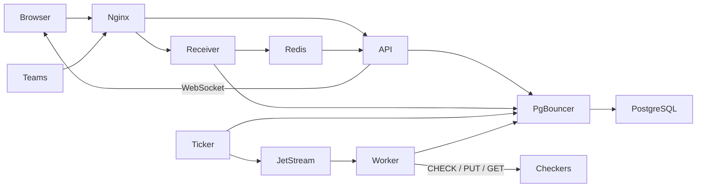

# Architecture

ForcAD deploys one Go binary as four services. PostgreSQL owns game state, Redis distributes public events and shared admission limits, and NATS JetStream delivers checker jobs.

## Runtime

| Process | Default replicas | Responsibility |
| --- | ---: | --- |
| `api` | 4 | Public and admin REST endpoints, scoreboard snapshots and WebSocket events |
| `receiver` | 2 | `PUT /flags`, scoring and per-flag verdicts |
| `worker` | 4 | Checker execution, eight concurrent slots per replica |
| `ticker` | 1 | Round scheduling, job publication and expiry |

The [Compose file](../deployment/docker/compose.yml) sets `FORCAD_ROLE` per service; the binary also accepts `all` and defaults to `api`. Nginx serves the frontend and routes requests. PgBouncer pools database connections by role. `postgres-data`, `config-loader` and `initializer` prepare storage, stage config, migrate and seed a new game.

## Request and job flow

**Flag submissions.** A receiver accepts up to 100 flags per batch, independently of the checker queue. Redis charges the team by flag across replicas. PostgreSQL locks team/service rows in a consistent order and scores in input order within one transaction. The receipt round determines expiry; uniqueness constraints prevent duplicate awards. HTTP 200 carries individual verdicts; a storage failure rolls back the batch and returns 503.

**NPCs.** Checkers target NPC vulnboxes on normal rounds. Duplicate submissions follow the same rules, but capturing an NPC flag does not change scores or publish a capture event. The teams page lists the NPC IP separately from the rankings.

**Checker jobs.** The ticker records jobs in PostgreSQL before publishing IDs in bounded batches. Only confirmed publications are marked sent. A worker claims a job with an expiring token, runs the [checker](CHECKERS.md), commits the result, then acknowledges delivery. Redelivery consults SQL state. If a worker may already have executed PUT, expiry settles the job as `CHECK_FAILED` instead of replaying it.

If a claim, renewal or deadline update loses its commit response, the worker rereads the committed state under a separate timeout. It continues only for the same token and generation, a live job and the expected update. The read does not renew the lease or retry PUT.

**Scoreboard.** Public cells come from completed-round snapshots; runtime status shows pending checks. Overlapping scoreboard reads share a load on each API replica and read one database snapshot. Runtime status coalesces concurrent reads without caching completed results. One caller canceling does not cancel a shared read. After a WebSocket reconnect, the browser fetches a new REST snapshot; scoring does not depend on event delivery.

## Concurrency and shutdown

HTTP requests in flight, database connections and checker slots have separate per-process limits. Workers pull only for free slots; JetStream's `MaxAckPending` limits outstanding deliveries across all workers. Keep one ticker. See [resource limits](OPERATIONS.md#resource-limits) before adding replicas.

- **Drain:** stop admitting HTTP and checker work and stop scheduling. In-flight work gets the shutdown deadline. Other workers can still consume the queue.
- **Broker disconnect:** readiness and intake stop. Active workflows get up to 30 seconds to settle, then 5 seconds for cleanup. An unresponsive handler forces process replacement. Reconnect backoff resets after a minute of connectivity; job expiry and ownership still apply.
- **Unreaped checker:** the process keeps its slot until the OS reaps it. The worker stops accepting work, becomes unready and exits nonzero after bounded cleanup. A late reap frees the slot but does not reopen admission. [Monitoring](MONITORING.md) exposes outstanding processes, their oldest age and cleanup failures.

## Frontend languages

The scoreboard and admin UI default to Russian; the language switch persists RU/EN in `forcad-language`. Dates, scores, validation messages and accessibility labels follow the selection. Team names and checker output are unchanged. The [translation namespaces](../frontend/src/shared/i18n/) share typed keys and interpolation variables. Grafana dashboards are English only.

## Backend layout

| Under [`backend/`](../backend/) | Responsibility |
| --- | --- |
| `cmd/forcad/`, `config/`, `internal/bootstrap/` | Commands, validated settings, Wire assembly and shutdown |
| `internal/domain/`, `internal/usecase/`, `internal/port/outbound/` | Game entities, scoring, operations and storage/messaging interfaces |
| `internal/adapter/primary/` | chi/ogen HTTP routing, `http/v1` handlers, middleware and WebSocket transport |
| `internal/adapter/secondary/` | pgx/sqlc storage, Redis, JetStream, metrics and checker processes |
| `internal/worker/`, `internal/operator/` | Scheduler and checker workflows; local setup and Compose commands |
| `db/`, `codegen/`, `integration_test/` | Migrations, source queries, generator settings and integration tests |

Generated Go code lives beside its consumer. See [code generation](DEVELOPMENT.md#code-generation).
