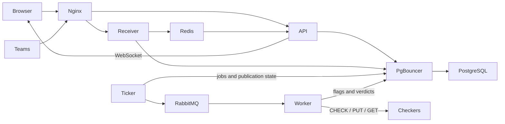

# Architecture

[Documentation index](../README.md#documentation)

ForcAD has one Go backend and separately deployed process roles. All roles use
the same game rules, database schema and release. A single `forcad` binary selects
its role through `FORCAD_ROLE`.

## Runtime

The [default Compose file](../deployment/docker/compose.yml) starts:

| Service | Replicas | Responsibility |
| --- | --- | --- |
| `api` | 4 | Public and admin REST endpoints; native WebSocket events |
| `receiver` | 2 | Flag submission at `/flags` and per-flag results |
| `worker` | 2 | RabbitMQ consumption and external checker execution |
| `ticker` | 1 | Round scheduling, job publication and expired-job recovery |
| `nginx` | 1 | Frontend assets and routing to API/receiver replicas |
| `pgbouncer` | 1 | Transaction pooling with separate server budgets per application role |
| `postgres` | 1 | Authoritative game state, flags, scores, sessions and jobs |
| `redis` | 1 | Shared admission limits and public event distribution |
| `rabbitmq` | 1 | Checker job delivery |

`initializer`, `config-loader` and `postgres-data` are startup jobs. They prepare
configuration/storage, apply embedded migrations and initialize a new game.

The Go worker replaces Celery. Python remains in the worker image for checker
programs. Admin and public APIs share the `api` service. Events also run there;
there is no separate Socket.IO service or Flower dashboard.

The optional monitoring overlay adds Prometheus and Grafana. Application metrics
describe ForcAD; router counters and a passive Zeek sensor describe game traffic.
See [Monitoring](MONITORING.md) and the [network layout](../infrastracture/README.md).

## Request and job flow

Flag submissions are handled by the receiver directly, independently of the
checker queue. A batch contains at most 100 flags. Each has its own result;
HTTP 200 does not mean every flag was accepted. Each batch uses one transaction:
read flags together, lock affected team/task rows in a stable order, calculate
scores in input order, then bulk-write stolen flags and final scores. Unique
constraints prevent repeat awards. Storage failures roll back the whole batch
and return 503, never an invalid-flag verdict. Expiry uses the round at receipt
of the decoded batch, before database waits. Redis charges a shared budget
in flags per team across receiver replicas.

The ticker stores jobs and their publication state in PostgreSQL, then publishes
job IDs to RabbitMQ with broker confirmation. Workers claim jobs with expiring
ownership, execute [checker workflows](CHECKERS.md), and persist results before
acknowledging queue messages. Duplicate delivery is expected and checked against
the durable job state. An interrupted workflow that may have performed PUT is
not blindly replayed; expired work is closed as `CHECK_FAILED`.

Public score cells use completed-round snapshots. Runtime status reports the
current phase and waiting checks separately. API replicas broadcast public
updates through Redis. Event delivery is not part of the scoring transaction;
the browser reloads a REST snapshot when its WebSocket reconnects.

Teams, tasks, flags, log entries, dispatch runs and checker jobs use UUIDv7 IDs.
The database stores native UUIDs; REST and event payloads expose UUID strings.
Round numbers and counters remain integers. Configuration and session tables
each use a fixed singleton key, while schedules use descriptive string keys.

## Concurrency and shutdown

Concurrency is bounded per process. HTTP admission limits requests in flight,
pgx limits database connections, and worker slots limit checker processes.
RabbitMQ prefetch follows worker concurrency. Adding replicas multiplies these
limits, so their total must fit the database and host capacity.

The scoreboard cache combines overlapping loads within one API replica.
Runtime status uses singleflight without caching completed results. A caller
can cancel its wait without aborting other callers; shared reads have a timeout
and stop when the application shuts down. Database reads for a scoreboard share
one transaction snapshot. Scoring writes keep their transaction locks and
duplicate checks.

The dispatcher publishes bounded batches before waiting for RabbitMQ confirms.
Only acknowledged IDs are checkpointed in PostgreSQL. Unknown publication
outcomes remain eligible for retry; SQL job claims prevent duplicate execution.

Drain rejects new HTTP requests, stops scheduling and stops taking checker jobs.
In-flight work gets the configured shutdown deadline to finish. Unacknowledged
jobs remain recoverable through RabbitMQ and the stored job state. Drain does
not empty the shared queue: other worker replicas can continue consuming it.
Public events are best effort; PostgreSQL remains the source of truth when a
browser reconnects.

## Frontend languages

The public pages and admin panel support Russian and English. Russian is the
default. The header's RU/EN switch updates the page without reloading and saves
the choice in browser storage (`forcad-language`). Dates, scores, validation
messages and accessibility labels follow the selected language. Team/service
names and checker output remain as supplied by the server.

Translations live in `frontend/src/shared/i18n/`: `shell`, `common`, `public`
and `admin` namespaces. Keys are checked by TypeScript; tests check both
languages for matching keys and interpolation variables. Changing language
does not change API requests, game state or WebSocket subscriptions.

## Backend layout

| Path under `backend/` | Responsibility |
| --- | --- |
| `cmd/forcad/main.go` | Command dispatch, logger/config setup and process exit |
| `config/` | Environment and game YAML validation |
| `internal/bootstrap/` | Wire assembly, startup and graceful shutdown |
| `internal/domain/` | Game entities, lifecycle types and scoring rules |
| `internal/usecase/` | Authentication, game operations and flag submission |
| `internal/port/outbound/` | Interfaces required from storage and messaging |
| `internal/adapter/primary/` | HTTP handlers and WebSocket transport |
| `internal/adapter/primary/http/v1/` | Domain-specific API handlers; routing stays in `http/router.go` |
| `internal/adapter/primary/http/middleware/` | Request deadlines, body/admission limits, origin checks and request context |
| `internal/adapter/primary/websocket/` | WebSocket connections and public event delivery |
| `internal/adapter/secondary/` | PostgreSQL, Redis, RabbitMQ, metrics and checker processes |
| `internal/worker/` | Scheduler and checker workflow orchestration |
| `internal/operator/` | Local setup, Compose selection and cleanup |
| `db/` | Embedded migrations and handwritten queries |
| `codegen/` | ogen and sqlc configuration |
| `integration_test/` | Tests using real dependencies, fixtures and runners |

HTTP uses chi and ogen; storage uses pgx and sqlc. Wire assembles dependencies.
Logging uses `log/slog` with a bounded output queue. Basic HTTP middleware lives
in the HTTP adapter. The wahrwelt-kit packages still provide caching, WebSockets,
HTTP metrics, readiness checks and trusted-proxy parsing. Generated code lives beside its consumer; see
[code generation](DEVELOPMENT.md#code-generation).

API, receiver and worker replicas can be adjusted independently. Keep the default
single ticker. Compose uses soft memory reservations per container, with optional
hard caps. These settings do not establish measured throughput or guaranteed RAM.
See [Operations](OPERATIONS.md).
