# Infrastructure

Debian 12/13 with ifupdown: separate router, VPN and ForcAD hosts, plus one VLAN
per team. Configs cover routing, firewalls, SNAT, WireGuard and monitoring.

## Generate configs

From `infrastracture/` on a workstation with Python 3.11+:

```sh
cp -n network.example.toml network.toml
# Edit WAN address, gateway, VPN endpoint, NIC names and service ports.
python3 render.py
# New VPN deployment only; requires wireguard-tools:
python3 vpn/generate.py
```

`.nft.in` files are templates; `runtime/` contains ordinary configs to review
and copy. Neither command applies host settings. Both refuse existing output;
use `python3 render.py --output runtime/revision` to compare a new revision.
Keep deployed WireGuard keys when updating network rules.

`network.toml` and `runtime/` are ignored by Git. Output directories are 0700,
files 0600. Distribute only each recipient's own VPN config.

| Host | Guide | Output under `infrastracture/` |
| --- | --- | --- |
| Router | [Router setup](router/README.md) | `runtime/router/` |
| VPN | [VPN setup](vpn/README.md) | `runtime/vpn/`, `runtime/wireguard/server/` |
| ForcAD | [ForcAD setup](forcad/README.md) | `runtime/forcad/` |

All internal networks use `10.183.0.0/16`: VPN transit `10.183.1.0/30`, ForcAD
`10.183.2.0/24`, team N at `10.183.(100+N).2/24` with gateway `.1`, participant VPN
`10.183.200.0/24`, admin VPN `10.183.201.0/24`.
Supported: 1-32 teams, 1-5 peers per team, 1-253 admins.
Each team gets a /29 VPN group; each peer has a unique /32. Participant `.1` is
reserved for the VPN server.

When migrating an existing installation, update router/VPN interfaces and rules,
vulnbox addresses and gateways, ForcAD team IPs and `traffic_cidrs`, monitoring
targets and sensor inventory together. Update WireGuard addresses and AllowedIPs
on both servers and clients, keeping all keys. Use console access and retain the
old configs for rollback. Clients route `10.183.0.0/16`, not the whole `10.0.0.0/8`.

## Access policy

| Source | Game mode | Pre-game mode |
| --- | --- | --- |
| Participant VPN | Game ports on all vulnboxes; management ports on own box | Ping only, including own box |
| Admin VPN | Full access | Full access |
| ForcAD checkers | Game ports on all vulnboxes | Same |
| Vulnboxes | Outbound Internet; no new direct connections to other vulnboxes or private infrastructure | Same |

Participants can reach the board in both modes. Router mode changes are manual,
independent of the ForcAD schedule. Attack tools run on VPN-connected team hosts.
Vulnboxes may use local firewalls and application filters while preserving service
functionality; nginx is optional.

The VPN preserves peer addresses. After access checks, the router SNATs VPN and
checker traffic to the destination VLAN gateway. Internet egress uses WAN
masquerade. Blocking direct vulnbox connections does not prevent indirect relays
through external hosts or team-controlled connections.

## Network diagram

Default: 20 teams. The diagram uses generic `eth` labels; the example config
uses `ens19` through `ens22`. The switch must enforce one access
VLAN per guest and a trunk on the router port. Guests must have no bypass path.

VPN rules live on the VPN server. The router loads `game.nft` or `pre-game.nft`,
both including `common.nft`. Solid lines are network links; dotted arrows are
policy and telemetry. Changing the team count does not update this illustration.

```mermaid
flowchart TB
    Teams["Team workstations / attack hosts<br/>Participant VPN: 10.183.200.0/24"]
    Admins["Organizer workstations<br/>Admin VPN: 10.183.201.0/24"]
    Internet(("Internet"))

    Teams ---|"WireGuard UDP/56767"| Internet
    Admins ---|"WireGuard UDP/56768"| Internet

    subgraph Router["Machine: Router / Firewall"]
        direction TB

        R_ETH0["eth0 - WAN<br/>Public IP<br/>DNAT UDP/56767 and UDP/56768<br/>to the same ports on 10.183.1.2"]
        R_ETH1["eth1 - 10.183.1.1/30<br/>Routes: 10.183.200.0/24 and 10.183.201.0/24<br/>via 10.183.1.2"]
        R_ETH2["eth2 - 10.183.2.1/24"]
        R_ETH3["eth3 - 802.1Q trunk<br/>VLANs 101-120<br/>Gateways: 10.183.101.1 - 10.183.120.1"]

        Routing["Routing / nftables<br/>Shared rules: common.nft<br/>Load game.nft OR pre-game.nft<br/>Source validation per interface"]

        Access["Access policy<br/>Game ports + own-team management<br/>Pre-game: participant ping only<br/>No direct vulnbox-to-vulnbox connections"]

        NAT["NAT policy<br/>VPN / checker traffic to vulnboxes:<br/>SNAT to the target VLAN gateway<br/>Internet egress:<br/>masquerade to the WAN address"]

        Observe["Router network exporter<br/>Original source and target before game SNAT<br/>Byte and packet counters"]

        Sensor["Optional: Zeek game traffic sensor<br/>Passive capture on eth1, both directions<br/>Original VPN peer and target vulnbox<br/>HTTP/1 requests, WebSocket upgrades<br/>TCP/UDP flows and capture health"]
        R_ETH1 -.->|"Capture before filtering and SNAT"| Sensor

        R_ETH0 --- Routing
        R_ETH1 --- Routing
        R_ETH2 --- Routing
        Routing --- R_ETH3

        Access -.->|"Access checks before game SNAT"| Routing
        NAT -.->|"Address translation policy"| Routing
        Routing -.->|"Traffic accounting before game SNAT"| Observe
    end

    Internet ---|"WAN uplink"| R_ETH0

    subgraph WGServer["Machine: WireGuard Server"]
        direction TB

        WG_ETH0["eth0 - 10.183.1.2/30<br/>Default gateway: 10.183.1.1"]
        WireGuard["WireGuard<br/>wg-attack: UDP/56767<br/>wg-admin: UDP/56768<br/>Unique peer IPs enforced by AllowedIPs<br/>Original peer addresses preserved"]
        WGFirewall["nftables: vpn/firewall.nft<br/>Source validation on VPN interfaces<br/>Participant /29 groups isolated<br/>Participants cannot access the admin VPN<br/>No SNAT on the VPN server"]

        WG_ETH0 --- WireGuard
        WGFirewall -.->|"VPN input / forwarding policy"| WireGuard
    end

    R_ETH1 ---|"10.183.1.0/30"| WG_ETH0

    subgraph ForcadHost["Machine: ForcAD / Checkers / Monitoring"]
        direction TB

        C_ETH0["eth0 - 10.183.2.10/24<br/>Default gateway: 10.183.2.1"]
        ForcAD["ForcAD<br/>Scoreboard / API / flag receiver"]
        Checkers["Checkers<br/>Service availability and flag checks"]
        Prometheus["Prometheus<br/>Private monitoring endpoints"]
        Grafana["Grafana - organizers only<br/>Team-to-team traffic overview<br/>Separate ForcAD HTTP / WS metrics"]

        C_ETH0 --- ForcAD
        C_ETH0 --- Checkers
        C_ETH0 --- Prometheus

        ForcAD -.->|"ForcAD application metrics"| Prometheus
        Prometheus -.->|"Dashboard queries"| Grafana
    end

    R_ETH2 ---|"10.183.2.0/24"| C_ETH0
    Observe -.->|"Router metrics scraped by Prometheus"| Prometheus

    Sensor -.->|"Game metrics on private TCP/9911"| Prometheus

    Bridge["vmbr1 - VLAN-aware bridge / switch<br/>Router port: trunk, VLANs 101-120<br/>VM ports: assigned access VLAN only<br/>Guests cannot select another VLAN"]

    R_ETH3 ---|"802.1Q trunk: VLANs 101-120"| Bridge

    subgraph Vulnboxes["Team Vulnboxes"]
        direction LR

        V01["vulnbox-01<br/>eth0 - untagged<br/>10.183.101.2/24<br/>Gateway: 10.183.101.1"]
        V02["vulnbox-02<br/>eth0 - untagged<br/>10.183.102.2/24<br/>Gateway: 10.183.102.1"]
        V03["vulnbox-03<br/>eth0 - untagged<br/>10.183.103.2/24<br/>Gateway: 10.183.103.1"]
        V04_17["vulnbox-04 ... vulnbox-17<br/>eth0 - untagged<br/>10.183.1NN.2/24<br/>Gateway: 10.183.1NN.1"]
        V18["vulnbox-18<br/>eth0 - untagged<br/>10.183.118.2/24<br/>Gateway: 10.183.118.1"]
        V19["vulnbox-19<br/>eth0 - untagged<br/>10.183.119.2/24<br/>Gateway: 10.183.119.1"]
        V20["vulnbox-20<br/>eth0 - untagged<br/>10.183.120.2/24<br/>Gateway: 10.183.120.1"]
    end

    Bridge ---|"Access VLAN 101"| V01
    Bridge ---|"Access VLAN 102"| V02
    Bridge ---|"Access VLAN 103"| V03
    Bridge ---|"Access VLANs 104-117"| V04_17
    Bridge ---|"Access VLAN 118"| V18
    Bridge ---|"Access VLAN 119"| V19
    Bridge ---|"Access VLAN 120"| V20

    TeamPolicy["Vulnbox policy<br/>Local filtering allowed; services must work<br/>Reverse proxy optional<br/>Outbound Internet through router"]

    TeamPolicy -.->|"Team-controlled filtering"| Vulnboxes

    classDef iface fill:#fff4e6,stroke:#d98235,stroke-width:2px,color:#222
    classDef service fill:#ecfaee,stroke:#508d59,stroke-width:2px,color:#222
    classDef vulnbox fill:#fcf0ff,stroke:#9255a3,stroke-width:2px,color:#222
    classDef bridge fill:#f1f3f5,stroke:#62676d,stroke-width:2px,color:#222
    classDef internet fill:#ffffff,stroke:#45454f,stroke-width:2px,color:#222
    classDef policy fill:#fff8db,stroke:#aa8730,stroke-width:1px,color:#222
    classDef monitoring fill:#eaf3ff,stroke:#4f7cac,stroke-width:2px,color:#222

    class R_ETH0,R_ETH1,R_ETH2,R_ETH3,C_ETH0,WG_ETH0 iface
    class ForcAD,Checkers,WireGuard,Routing service
    class V01,V02,V03,V04_17,V18,V19,V20 vulnbox
    class Bridge bridge
    class Internet,Teams,Admins internet
    class Access,NAT,WGFirewall,TeamPolicy policy
    class Observe,Prometheus,Grafana monitoring
    class Sensor monitoring

    style Router fill:#fdf4ff,stroke:#dfb8e8,stroke-width:2px
    style ForcadHost fill:#fffaf0,stroke:#e8cba0,stroke-width:2px
    style WGServer fill:#effffc,stroke:#9cded4,stroke-width:2px
    style Vulnboxes fill:#fdf8ff,stroke:#d8b8e0,stroke-width:1px
```



## Monitoring

ForcAD metrics describe the board and flag receiver. Router counters provide
packets and bytes; the optional Zeek sensor adds plaintext HTTP/1 RPS, observed
WS connections and TCP/UDP flows by source and target team. It captures the VPN
interface in both directions before filtering and SNAT. TLS and HTTP/2 are not
covered. See [Monitoring](../docs/MONITORING.md) for setup links and limitations.

## Verification

From this directory:

```sh
make test
make test-network
make test-game
make test-dashboards
```

- `test`: allocation, validation, output permissions and WireGuard key consistency.
- `test-network`: rendered firewalls, SNAT, game/pre-game access, spoofing,
  isolation, reloads and ifupdown parsing in disposable Debian 12 containers.
- `test-game`: Zeek parsing, attribution, metrics endpoint and recording rules.
- `test-dashboards`: all five dashboards and their PromQL, including a synthetic
  20-team fixture.

Container checks need Docker; capabilities stay inside test namespaces. They do
not change host rules. The [two-team demo](../deployment/demo/README.md) adds real
WireGuard and application traffic.

Before the event, test reboot persistence, VLAN isolation, MTU, real checkers and
expected peak load on the intended hosts. Container checks use the workstation's
kernel and do not establish production capacity. Installation and rollback steps
are in the host guides above.
